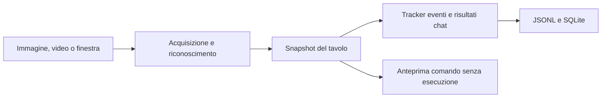

# Poker Bot - percorso verso un sistema operativo su PokerStars

L'obiettivo finale del progetto è avere un sistema completo operativo su PokerStars: leggere il tavolo, ricostruire la mano, scegliere un'azione valida, eseguirla e verificarne l'esito. Questa repository contiene la base di osservazione e registrazione su cui costruire quel ciclo completo.

**Stato attuale:** prototipo locale calibrato sul tema italiano di PokerStars nel browser. Acquisisce immagini, riconosce carte e importi, ricostruisce una sequenza parziale di eventi e salva i risultati in JSONL e SQLite. Non sono ancora implementati un motore strategico completo e un esecutore operativo sul tavolo reale; il programma attuale non esegue click o puntate.

L'uso attivo sulla piattaforma è subordinato a un accordo esplicito con l'operatore: le [regole pubbliche di PokerStars](https://www.pokerstars.com/poker/room/prohibited/) vietano bot e assistenza decisionale in tempo reale. L'obiettivo tecnico non implica un'autorizzazione già disponibile.

## Come leggere la repository

1. **Partire da questo README:** descrive obiettivo, stato attuale, avvio, output e limiti.
2. **Leggere la [roadmap tecnica](ROADMAP_ATTIVAZIONE_POKERSTARS.md)**, disponibile anche in [PDF](ROADMAP_ATTIVAZIONE_POKERSTARS.pdf): contiene i difetti riprodotti, i componenti mancanti e i criteri per completare l'esperimento.
3. **Seguire il flusso dei dati:** `stars_reader.py` orchestra acquisizione, riconoscimento e registrazione. `mac_capture.py` e `native/WindowStream.swift` forniscono le immagini; `assets/` contiene i template delle carte.
4. **Esaminare la memoria e i risultati:** `hand_tracker.py` deduce gli eventi tra frame; `hand_results.py` conferma i pagamenti espliciti della chat. Le due fonti non costituiscono una storia completa della mano.
5. **Esaminare la persistenza e le anteprime:** `poker_store.py` definisce lo schema SQLite; `dry_run.py` descrive richieste e regioni visive senza eseguire azioni.
6. **Controllare le prove:** `tests/` verifica il comportamento attuale; [docs/validation.md](docs/validation.md) distingue calibrazione, regressioni e limiti delle verifiche live storiche.



## Cosa manca per arrivare all'obiettivo finale

| Componente | Stato attuale | Lavoro necessario |
| --- | --- | --- |
| Acquisizione e riconoscimento | Presenti, calibrati su un layout | Verificare dati indipendenti, transizioni, oscuramenti e latenza |
| Ricostruzione della mano | Presente, con difetti noti | Correggere confini delle mani, cambi di street, ordine delle azioni e importi incerti |
| Motore decisionale | Non implementato nel nucleo | Definire strategia, azioni valide, importi e comportamento con dati insufficienti |
| Lettura dei controlli | Regioni indicative | Riconoscere pulsanti, costo della chiamata, limiti e valore del campo importo |
| Esecuzione | Solo anteprime | Integrare un esecutore con verifica immediata dello stato e invio singolo |
| Conferma e recupero | Non integrati con un esecutore | Confermare gli esiti, gestire timeout e riavvii, impedire duplicazioni |
| Validazione completa | Test del nucleo e prove storiche | Preparare un banco di prova e dimostrare l'intero ciclo prima dell'eventuale test autorizzato |

Il progetto sarà tecnicamente completo quando l'intero ciclo sarà verificato, inclusi i casi di incertezza e arresto. Il superamento dei test attuali non certifica né la prontezza alla produzione né la redditività di una strategia.

## Installazione

Usare Python 3.10 o successivo. Nella cartella del progetto:

```bash
python3 -m venv .venv
.venv/bin/python -m pip install -r requirements.txt
```

Tesseract deve essere disponibile nel PATH. FFmpeg è necessario solo per leggere video. Su macOS, se non già installati:

```bash
brew install tesseract ffmpeg
```

La cattura live richiede macOS, il permesso Registrazione schermo e una toolchain Swift con le API ScreenCaptureKit usate in `native/WindowStream.swift`. Il programma compila automaticamente l'helper quando manca o è da aggiornare. L'ambiente `.venv/` già presente può essere riutilizzato.

## Avvio

Elencare le finestre disponibili e avviare una lettura limitata sulla finestra scelta, sostituendo `12345` con l'ID corrente:

```bash
.venv/bin/python stars_reader.py --list-windows
.venv/bin/python stars_reader.py --window-id 12345 --fps 5 --limit 30 --quiet
```

Senza `--window-id`, il programma cerca un solo tavolo leggibile. Senza `--limit`, continua fino a Ctrl+C. Il valore FPS è un obiettivo di acquisizione: il tempo richiesto dall'OCR può ridurre il numero di frame elaborati.

La cattura resta associata alla finestra selezionata. Chiusura, cambio titolo o errori di lettura producono segnalazioni; il programma non seleziona automaticamente un altro tavolo. Il backend `--capture-backend legacy` usa `screencapture`; l'helper Swift utilizzato dal backend predefinito è esclusivamente `WindowStream.swift`.

Per analizzare dati già disponibili:

```bash
.venv/bin/python stars_reader.py --image tests/fixtures/218.png
.venv/bin/python stars_reader.py --video /percorso/registrazione.mov --fps 1
.venv/bin/python stars_reader.py --frames /percorso/cartella_png
```

L'esempio immagine richiede la fixture locale. Le immagini della cartella vengono lette in ordine alfabetico.

## Output e diagnostica

Le sessioni live creano automaticamente i file in `sessions/`. Con `--log /percorso/run.jsonl`, vengono prodotti:

| File | Contenuto |
| --- | --- |
| `run.jsonl` | Snapshot, carte, importi, qualità della lettura e stato del tracker |
| `run.events.jsonl` | Eventi dedotti dal tracker |
| `run.hands.jsonl` | Pagamenti espliciti confermati nella chat visibile |
| `run.sqlite` | Sessione, snapshot, posti, eventi e risultati |

`--db` permette di scegliere un database diverso, anche senza `--log`. Usare un nome nuovo per i log: quelli esistenti non vengono sovrascritti. I risultati della chat possono riferirsi a mani precedenti e non sono un registro completo di profitto o perdita.

Le immagini vengono salvate solo su richiesta: `--raw-dir` conserva le catture originali, `--raw-every N` ne riduce la frequenza e `--debug-dir` produce immagini annotate. Usare cartelle nuove per ogni prova per evitare di sovrascrivere immagini precedenti.

`--detect-controls` mostra regioni visive indicative. `--dry-run-action` e `--dry-run-amount` producono soltanto anteprime: pulsanti individuali, importi legali e coordinate desktop non sono ancora verificati.

## Struttura essenziale

| Percorso | Funzione |
| --- | --- |
| `stars_reader.py` | CLI, riconoscimento delle carte e OCR |
| `mac_capture.py`, `native/WindowStream.swift` | Acquisizione della finestra su macOS |
| `hand_tracker.py` | Memoria temporale e deduzione degli eventi |
| `hand_results.py` | Lettura e conferma dei risultati nella chat |
| `poker_store.py` | Persistenza SQLite |
| `dry_run.py` | Anteprime e regioni visive dei controlli |
| `assets/` | Template necessari per riconoscere le carte |
| `tests/` | Test del nucleo e fixture locali di regressione |
| `docs/` | Storico delle verifiche e riferimenti visivi delle coordinate |
| `sessions/` | Registrazioni locali conservate per analisi e replay |
| `ROADMAP_ATTIVAZIONE_POKERSTARS.md` e `.pdf` | Lavori mancanti e criteri di validazione |

Le vecchie demo locali, i documenti sul bet sizing, il relativo script editoriale e l'helper Swift di cattura singola non utilizzato sono stati rimossi. Non sono dipendenze del lettore. Le coordinate storiche sono in [docs/coordinate_reference](docs/coordinate_reference/PokerStars%20coordinate%20reference.md).

## Test e limiti

```bash
.venv/bin/python -m unittest discover -s tests -v
```

La suite del nucleo comprende 42 test. Le fixture in `tests/fixtures/`, le immagini annotate in `docs/coordinate_reference/`, le sessioni, i database di osservazione e i rapporti live privati sono esclusi da Git: su un clone pulito i test visivi vengono saltati finché non sono disponibili le immagini. I template in `assets/` sono invece necessari al funzionamento e versionati. La documentazione delle coordinate è pubblicata come testo; i suoi screenshot di riferimento restano locali.

Il riconoscimento è calibrato su un layout specifico; altre dimensioni, temi o sovrapposizioni possono causare errori. Confidenze OCR e similarità dei template non sono probabilità calibrate. Un elenco `issues` vuoto non certifica la correttezza dello snapshot.

Il tracker presenta ancora problemi noti sui confini delle mani, sui cambi di street, sull'ordine delle azioni e sulla propagazione degli importi sconosciuti. La pulizia della repo non modifica questi comportamenti. Dettagli nella [roadmap](ROADMAP_ATTIVAZIONE_POKERSTARS.md) e nello [storico di validazione](docs/validation.md).
